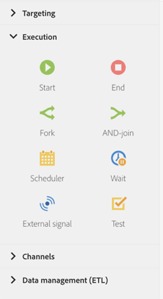

# 실행 활동 기본 정보{#about-execution-activities}

화면 왼쪽에 있는 팔레트에서 **[!UICONTROL Execution]** 섹션을 펼칩니다.

다음 활동은 워크플로의 구성 및 실행에만 적용됩니다. 이들의 주요 임무는 다른 활동을 조정하는 것입니다.

이 **[!UICONTROL Execution]** 섹션에는 다음 활동이 표시됩니다.

* [시작 및 종료](../../automating/using/start-and-end.md)
* [포크](../../automating/using/fork.md)
* [AND-결합](../../automating/using/and-join.md)
* [예약](../../automating/using/scheduler.md)
* [대기](../../automating/using/wait.md)
* [외부 신호](../../automating/using/external-signal.md)
* [테스트](../../automating/using/test.md)
