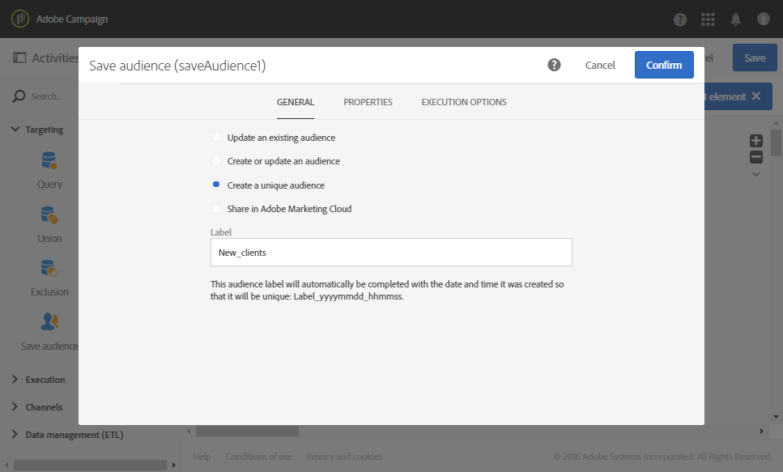

# 조정을 사용한 데이터 업데이트 {#data-update-reconciliation}

다음 예제에서는 새로운 고객을 포함하는 파일을 가져와 직접 대상자 프로필을 만드는 워크플로를 보여줍니다. 워크플로우는 다음 활동으로 구성됩니다.


* 가져올 파일의 데이터를 로드하여 검색하는 [파일 로드](../../automating/using/load-file.md) 활동. 가져온 파일에는 다음 데이터가 포함됩니다.

  ```
  lastname;firstname;email;dateofbirth
  jackman;megan;megan.jackman@testmail.com;07/08/1975
  phillips;edward;phillips@testmail.com;09/03/1986
  weaver;justin;justin_w@testmail.com;11/15/1990
  martin;babeth;babeth_martin@testmail.net;11/25/1964
  reese;richard;rreese@testmail.com;02/08/1987
  cage;nathalie;cage.nathalie227@testmail.com;07/03/1989
  xiuxiu;andrea;andrea.xiuxiu@testmail.com;09/12/1992
  grimes;daryl;daryl_890@testmail.com;12/06/1979
  tycoon;tyreese;tyreese_t@testmail.net;10/08/1971
  ```

* 로드된 파일의 각 열을 프로필 차원 열에 연결하는 [조정](../../automating/using/reconciliation.md) 활동. 식별할 수 없는 파일 레코드(데이터 누락, 호환되지 않는 데이터 형식 등)입니다. 최종 대상 데이터의 무결성을 유지하기 위해 무시됩니다.

  

* 대상자 프로필을 저장하는 [대상자 저장](../../automating/using/save-audience.md) 활동.

  
