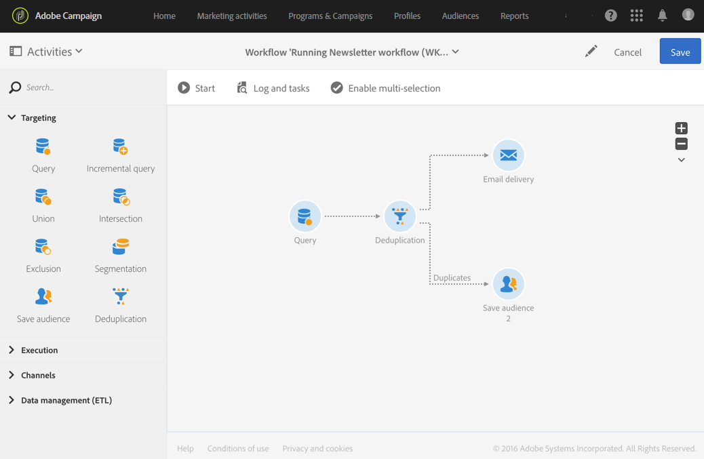

# 게재 전 중복 확인 {#identifying-duplicates-before-a-delivery}

다음의 예제에서는 이메일을 보내기 전에 타겟의 중복을 제외할 수 있는 중복 제거를 보여줍니다. 즉, 동일한 프로필에 커뮤니케이션을 여러 번 보내지 않습니다.

워크플로는 다음과 같이 구성됩니다.

* 전자 메일 대상을 정의할 수 있는 [쿼리](../../automating/using/query.md). 여기서 워크플로는 1년 이상 클라이언트 데이터베이스에 있었던 18세에서 25세 사이의 모든 프로필을 타겟으로 합니다.

  

* 이전 쿼리에서 얻은 중복을 식별할 수 있는 [중복 제거](../../automating/using/deduplication.md) 활동. 이 예제에서는 각 중복에 대해 하나의 레코드만 저장됩니다. 중복은 이메일 주소를 사용하여 식별됩니다. 즉, 이메일 게재는 각 이메일 주소가 타겟팅에 포함될 때마다 한 번만 전송될 수 있습니다.

  선택한 데이터 중복 제거 방법은 **[!UICONTROL Non-empty value]**&#x200B;입니다. 이를 사용하면 중복 시 유지한 레코드 중에서 **이름**&#x200B;이 제공된 레코드에 우선 순위가 부여되도록 할 수 있습니다. 이메일 콘텐츠의 개인화 필드에 이름을 사용할 경우 더욱 일관성 있게 됩니다.

  또한 중복을 유지하고 나열할 수 있도록 추가 전환이 추가되었습니다.

  

* 중복 제거의 기본 아웃바운드 전환 후 배치되는 [이메일 게재](../../automating/using/email-delivery.md).
* 중복 제거의 추가 전환 후 [대상자 저장](../../automating/using/save-audience.md) 활동을 배치하여 **중복** 대상자에서 중복을 저장합니다. 이 대상자는 모든 이메일 게재에서 멤버를 직접 제외하는 데 재사용할 수 있습니다.
