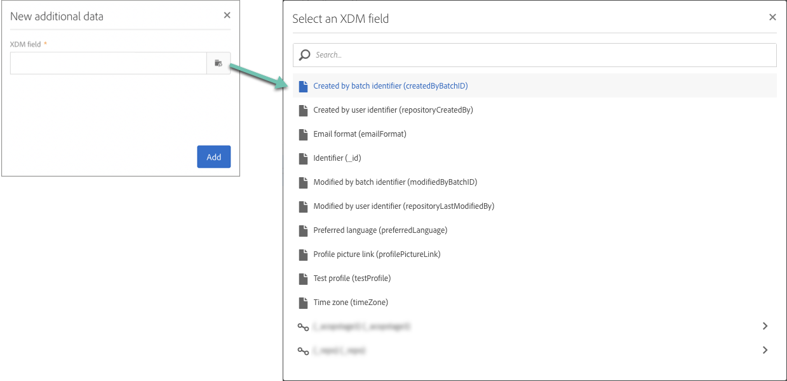

# Adobe Experience Platform 속성을 사용한 캠페인 개인화 {#personalizing-campaigns-using-aep-attributes}

>[!IMPORTANT]
>
>Audience Destinations 서비스는 현재 베타 버전이며, 예고 없이 자주 업데이트될 수 있습니다. 이러한 기능에 액세스하려면 고객을 Azure(현재 북미 지역의 경우에만 베타 버전)에서 호스팅해야 합니다. 액세스하려면 Adobe 고객 지원 센터에 문의하십시오.
>
>**푸시** 및 **인앱** 채널은 아직 Adobe Experience Platform의 컨텍스트 데이터를 사용하여 개인화할 수 없습니다.

워크플로우가 [Adobe Experience Platform 대상](../../integrating/using/aep-about-audience-destinations-service.md)으로 구성되면 XDM(Experience Data Model)에만 있는 프로필 속성을 사용하여 메시지를 개인화할 수 있습니다.

이렇게 하려면 다음 특성을 **[!UICONTROL Read audience]** 활동에 추가해야 합니다.

1. **[!UICONTROL Read audience]** 활동을 엽니다. **[!UICONTROL Additional data]** 탭에서 **[!UICONTROL Create element]** 단추를 클릭합니다.

   **[!UICONTROL Additional data]** 탭은 Adobe Experience Platform 대상자를 선택한 후에만 사용할 수 있습니다.

   

   >[!NOTE]
   >
   >이 기능에서는 배열 및 맵 데이터 형식이 지원되지 않습니다. 또한 유니온 스키마의 데이터만 선택기에 표시됩니다.

1. 목록에서 원하는 XDM 필드를 선택한 다음 **[!UICONTROL Confirm]**&#x200B;을(를) 클릭합니다.

   

1. **[!UICONTROL Add]** 단추를 클릭하여 추가 데이터 목록에 추가하십시오.

   

1. 워크플로우에 추가할 모든 XDM 필드에 대해 이 단계를 반복합니다.

   >[!NOTE]
   >
   >**[!UICONTROL Read audience]** 활동에서 최대 20개의 XDM 필드를 추가할 수 있습니다.

1. 모든 필드가 추가되었으면 **[!UICONTROL Confirm]** 단추를 클릭하여 변경 내용을 저장합니다. 이제 게재를 개인화하는 데 사용할 수 있습니다.

게재를 만들고 개인화하는 방법에 대한 자세한 내용은 Campaign Standard 설명서를 참조하십시오.

* [통신 채널 살펴보기](../../channels/using/get-started-communication-channels.md)
* [채널 활동 기본 정보](../../automating/using/about-channel-activities.md)
* [게재 개인화](../../designing/using/personalization.md)
