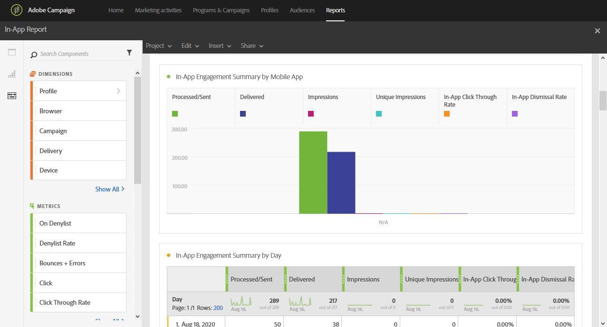

# 인앱 보고서{#in-app-report}

>[!CAUTION]
>
>게재 유형(이 경우 인앱 게재)에 따라 데이터를 분할하려면 **[!UICONTROL Message type]** 지표를 테이블로 끌어다 놓아야 합니다.

**인앱** 보고서는 인앱 게재와 관련된 세부 정보를 제공합니다.

각 테이블은 요약 번호와 차트로 표시됩니다. 세부 사항이 각각의 시각화 설정에 표시되는 방식을 변경할 수 있습니다.

첫 번째 테이블 **인앱 참여 요약**&#x200B;은(는) 일별, 모바일 앱별 및 게재별로 세 가지 범주로 분할됩니다. 여기에는 게재에 대한 수신자 반응성에 사용 가능한 데이터가 포함됩니다.

* **[!UICONTROL Processed/sent]**: 인앱 게재에 대한 총 전송 수입니다.
* **[!UICONTROL Delivered]**: 보낸 총 메시지 수와 관련하여 인앱 메시지 수를 보냈습니다.
* **[!UICONTROL Impressions]**: 트리거 기준을 충족하는지 여부에 따라 받는 사람이 본 총 인앱 메시지 수입니다.
* **[!UICONTROL Unique impressions]**: 받는 사람의 노출 횟수.
* **[!UICONTROL In-App click through rate]**: 단추 1 또는 단추 2를 클릭한 사용자의 백분율과 메시지를 본 사용자의 백분율입니다.
* **[!UICONTROL In-App dismissal rate]**: 수신자가 해제한 인앱 메시지의 비율입니다.

두 번째 테이블 **인앱 클릭 및 해제**&#x200B;는 일별, 모바일 앱 및 게재별로 세 가지 범주로 분할됩니다. 여기에는 게재당 수신자 동작에 사용할 수 있는 데이터가 포함됩니다.

* **[!UICONTROL In-App clicks]**: 단추 1 또는 단추 2를 클릭한 총 받는 사람 수
* **[!UICONTROL Unique In-App clicks]**: 수신자가 단추 1 또는 단추 2를 클릭한 횟수입니다.
* **[!UICONTROL In-App dismissal]**: [닫기] 단추 또는 [자동 닫기]를 클릭하여 받는 사람이 해제한 총 메시지 수
* **[!UICONTROL Unique In-App dismissal]**: 인앱 메시지를 거부한 시간 받는 사람 수입니다.
