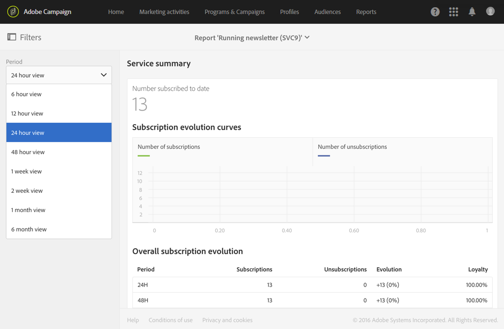

# 서비스 요약{#service-summary}

**[!UICONTROL Service summary]**은(는) 서비스의 구독 및 구독 취소의 진화에 대해 자세히 설명합니다.
이 보고서는 고급 메뉴 **[!UICONTROL Profiles & Audiences]** > **[!UICONTROL Services]**&#x200B;을(를) 통해서만 서비스 페이지에서 액세스할 수 있습니다. 자세한 정보는 이 [페이지](../../audiences/using/monitoring-subscriptions.md#service-reports)를 참조하십시오.

**[!UICONTROL Subscription evolution curves]** 시각화는 드롭다운 막대에서 선택한 **[!UICONTROL Period]**&#x200B;에 따라 구독 및 구독 취소 수에 대해 자세히 설명합니다.

**[!UICONTROL Overall subscription evolution]**&#x200B;을(를) 사용하면 다양한 기간 동안 구독자의 발전을 확인할 수 있습니다.
