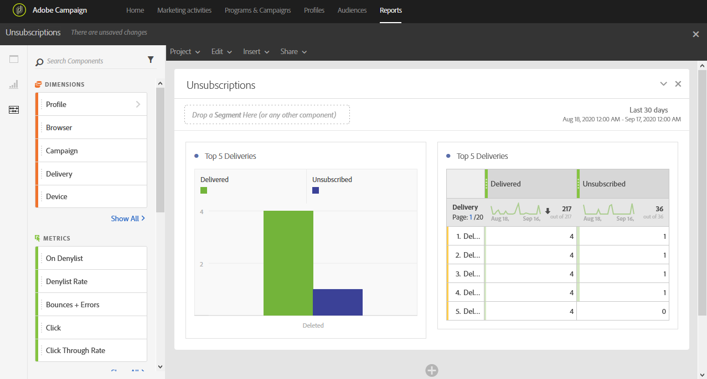

# 구독 취소 건수{#unsubscriptions}

**[!UICONTROL Unsubscriptions]** 보고서는 가장 많이 구독 해지된 게재 항목을 식별합니다.

**[!UICONTROL TOP 5 deliveries]** 테이블 및 그래프는 메시지가 가장 많이 게재된 상위 5개 게재 및 구독을 취소한 수신자 수를 표시합니다. 여기에 나열된 데이터는 메시지의 구독 취소 링크 클릭 수를 기반으로 합니다.
